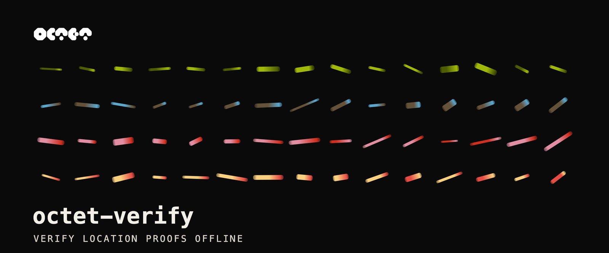

<p align="center">
  <a href="https://octetproof.com">
    
  </a>
</p>

<div align="center">

**Check an Octet location proof yourself: offline, open source, and without trusting Octet.**

[](https://crates.io/crates/octet-verify) [](https://docs.rs/octet-verify) [](LICENSE) [](https://github.com/octetproof/octet-verify)

[](https://octetproof.com) [](https://octetproof.com/docs/v3.0/concepts/verifying-proofs/) [](https://verifier.octetproof.com/)

</div>

> [!IMPORTANT]
> **Octet proves; you decide.** Octet gives you the tools to define a location
> policy and a signed proof of where a device was. It does not block, allow or
> change anything in your app or on your servers. Your backend verifies the proof
> (with this tool, for example) and decides what happens to the request. If your
> backend ignores the answer, nothing is enforced.

## What it is

`octet-verify` reads an Octet `LocationProof` and checks that it is authentic and
untampered. It prints every check it ran, and every check it could not run, so you
can see exactly what a pass means.

- **Offline.** A local proof is checked with no network call. Vendor roots are
  built in.
- **Open and auditable.** The byte-exact contract is in
  [`VERIFICATION-SPEC.md`](VERIFICATION-SPEC.md). You can re-implement it.
- **Verify, never create.** The crate holds none of the proof-creation logic: no
  spoof detection, no signal weights, no verdict thresholds. It checks the
  signatures over a verdict, not the judgement behind it.
- **Honest output.** A check that did not run is printed as `NOT-CHECKED`, never
  as a pass.

## Quick start

Install with Cargo:

```sh
cargo install octet-verify --features appattest,browser
```

Verify one of the real proofs kept in this repository:

```console
$ git clone https://github.com/octetproof/octet-verify && cd octet-verify
$ octet-verify test-vectors/golden/1.0.0/ios-onearth.bin \
    --hardware-pubkey test-vectors/golden/1.0.0/ios-onearth.pubkey \
    --max-age-seconds 999999999     # golden proofs are old; the default window is 300 s
== octet-verify ==
verdict: VALID

  [       PASS] freshness              13294003 s old (limit 999999999 s)
  [       PASS] stage-chain            8 stages, hash linkage intact
  [       PASS] stage-signatures       all 8 stage signatures verify (raw key from --hardware-pubkey)
  [       PASS] chain-assembly         final stage binds all 7 prior signatures
  [       PASS] field-binding          commitment, nullifier, zkProof bound to signed stage hashes
  [NOT-CHECKED] app-attest             no --app-attest-config supplied; App Attest evidence not checked
  ...
8 pass · 0 fail · 0 warn · 6 not-checked
```

Add `--json` for machine-readable output, and `--help` for every option.

> [!TIP]
> No Rust toolchain? The [web verifier](https://verifier.octetproof.com/) runs this
> same code in your browser, compiled to WebAssembly. The proof never leaves your
> machine.

## How it works

```text
  device + Octet SDK          your backend                          you
 ┌──────────────────┐  proof  ┌───────────────────────────────┐  ┌────────────────┐
 │ collects signals,│ ──────► │ octet-verify checks the proof:│─►│ decide: allow, │
 │ signs a proof    │         │ signatures, bindings, roots   │  │ step up, log … │
 └──────────────────┘         └───────────────────────────────┘  └────────────────┘
```

The SDK signs each stage of a proof with a hardware-backed key and binds the
stages into a chain. `octet-verify` rebuilds every signed message from the
proof's own bytes and checks it. The verdict inside the proof is trusted as a
signed value. What your service does with it is up to you.

## What a pass means

| Checked | How |
|---|---|
| Stage attestation chain | hash linkage, and each stage's ECDSA P-256 signature |
| Proof assembly | the final stage binds every earlier signature |
| Field bindings | commitment, nullifier, region, verdict, uncertainty and caller metadata are bound to the signed proof, so an edit after signing fails |
| Freshness and replay | the proof's *signed* timestamp; optional local replay store |
| Device identity | the Ed25519 transport signature, against a key you enrolled |
| Hardware attestation | Apple App Attest and the Android key-attestation chain, to the vendor roots (`appattest`) |
| Region assertions | `--expect-region`, `--expect-region-contains`, H3 and S2 cell sets |

| Reported as `NOT-CHECKED` | Why |
|---|---|
| Hardware key on a default build | without `appattest`, a pass proves the proof is consistent and signed by the key it carries, not that the key is genuine hardware |
| Online revocation | an offline verifier cannot read Google's status list |
| The ZK layer | its backend is a placeholder and adds no assurance yet |

> [!WARNING]
> **Exit `0` means authentic, not attested.** A proof with no hardware attestation
> still exits `0` when its signatures verify. To require attestation, build with
> `appattest` and pass `--require-attestation`, or read `attested` from `--json`.

The full trust model is in [`SECURITY.md`](SECURITY.md) and
[`INTEGRATION.md`](INTEGRATION.md#the-trust-model-in-practice).

## Commands

| Command | What it checks | Feature |
|---|---|---|
| `octet-verify <proof.bin>` | a mobile `LocationProof`, from a file or stdin | default |
| `octet-verify fetch / watch / range` | proofs pulled from Octet's API (which is untrusted: bytes go through the same checks) | `net` |
| `octet-verify browser-verdict <token>` | a browser verdict token and its key chain up to Octet's offline roots | `browser` |

## Cargo features

The default build has no network or JSON surface. Opt in to what you need:

| Feature | Adds |
|---|---|
| `appattest` | offline Apple App Attest and Android key attestation, via [`octet-attest-verify`](https://crates.io/crates/octet-attest-verify) |
| `browser` | the `browser-verdict` command |
| `caller-metadata` | `--caller-manifest` / `--content`: check what an app attached to a proof |
| `h3` | `--expect-region-contains` for H3 regions |
| `net` | the `fetch`, `watch` and `range` commands |
| `playintegrity` | online Google Play Integrity (networked; implies `net`) |

## Exit codes

| Code | Meaning |
|---|---|
| `0` | **Authentic**: no check failed and the signatures verified |
| `1` | **Invalid**: a check failed |
| `2` | usage, IO or decode error |
| `3` | **Inconclusive**: signatures not verified (for example, no hardware key), or caller content unresolved |

`INCONCLUSIVE` is never `0`, so `octet-verify proof.bin && accept` cannot accept
an unverified proof.

## As a library

```toml
[dependencies]
octet-verify = "1"
```

`octet_verify::verify::verify(&proof, &options)` returns a `Report` with the same
checks the CLI prints. See [docs.rs](https://docs.rs/octet-verify).

## Documentation

| Document | What it covers |
|---|---|
| [`INTEGRATION.md`](INTEGRATION.md) | how to wire it into a backend: worked examples, reading a verdict, enrolling device keys |
| [`VERIFICATION-SPEC.md`](VERIFICATION-SPEC.md) | the byte-exact contract: every signed message, every check |
| [`SECURITY.md`](SECURITY.md) | what a pass establishes, and how to report a vulnerability |
| [`CHANGELOG.md`](CHANGELOG.md) | what changed in each release |
| [`test-vectors/`](test-vectors/) | real signed proofs and vectors, kept verifiable forever |

## Security

Report a vulnerability as described in [`SECURITY.md`](SECURITY.md). Please do
not open a public issue for one.

## License

Licensed under the **Apache License 2.0**. See [`LICENSE`](LICENSE) and
[`NOTICE`](NOTICE). Copyright 2026 Understone, Inc. d/b/a Octet.
